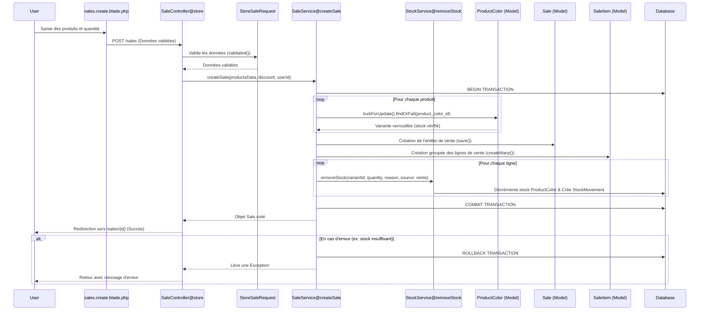

# Flux de Création d'une Vente

Ce document détaille le processus technique de création d'une vente au sein de l'application, de l'interface utilisateur jusqu'à la persistance en base de données.

## 1. Écran de caisse (`partials/pos.blade.php` + `resources/js/pos.js`)

Le même écran sert au front office (`/saler/create`) et au back office (`/admin/sales/create`).

- **Catalogue chargé une fois** (`Support/PosCatalog`) : variantes actives (en rupture comprises, non ajoutables), catégories avec leurs parents, marques, et les 24 meilleures ventes des 90 derniers jours (onglet par défaut). Recherche et filtres se font dans le navigateur, sans attente.
- **Ajout d'un article** : scan ou saisie du code (SKU) + Entrée, recherche par nom sans accents, ou toucher une vignette. `3*` avant l'article = 3 exemplaires. Le stock est vérifié avant l'ajout.
- **Clavier** : F2 recherche, +/− quantité de la ligne choisie, ↑/↓ choisir une ligne, Suppr retirer, F4 annuler la vente, F9 encaisser. Une frappe hors d'un champ (scanner) est redirigée vers la recherche.
- **Encaissement** : mode de paiement (espèces, Mobile Money, carte), remise, somme reçue avec billets proposés ; la monnaie à rendre est affichée en direct et la validation est bloquée si la somme est insuffisante.
- **Après validation** (AJAX, la caisse reste ouverte) : monnaie à rendre en grand, reçu ticket 80 mm imprimé automatiquement (`/receipt`, réglable par poste), stocks mis à jour, Entrée = client suivant.
- Le panier en cours et les réglages (bip, impression automatique) sont mémorisés sur le poste : un rechargement de page ne perd pas la vente.
- Données envoyées : `products[]` (`product_color_id`, `quantity`), `discount`, `payment_method`, `amount_received` (vide = montant exact), client facultatif.

## 2. Validation (`StoreSaleRequest.php`)

Le système valide les données entrantes avant d'atteindre le contrôleur :

- `products` : Tableau requis avec au moins un élément.
- `products.*.product_color_id` : Doit exister dans la table `product_colors` et être unique dans la requête (`distinct`).
- `products.*.quantity` : Entier positif (minimum 1).
- `discount` : Numérique, minimum 0.
- `payment_method` : facultatif, `cash` (défaut), `mobile_money` ou `card`.
- `amount_received` : facultatif, numérique, minimum 0 (somme remise par le client).

## 3. Orchestration (`SaleController@store`)

Le contrôleur agit comme un chef d'orchestre :

1. Récupère les données validées.
2. Appelle `SaleService->createSale()`.
3. Gère les exceptions (ex: stock insuffisant) via un bloc `try-catch` pour renvoyer un message d'erreur utilisateur (`with('error', ...)`).
4. Redirige vers la vue détaillée de la vente en cas de succès.
5. Appel AJAX de la caisse (`Accept: application/json`) : répond `201` avec la référence, la monnaie à rendre, l'adresse du reçu et le stock restant des articles vendus, ou `422` avec le message d'erreur. Logique partagée par les deux espaces : `Concerns\ChecksOutSales`.

## 4. Logique Métier (`SaleService@createSale`)

C'est le cœur critique du système. Toutes les opérations sont encapsulées dans une **Transaction SQL** (`DB::transaction`).

### Étape A : Initialisation

- Numéro de facture à la suite, avec un compteur par année (`FAC-2026-000123`, `DocumentNumberService`).
  Pris dans la transaction : une vente annulée rend son numéro, la suite n'a pas de trou.
- Identification de l'auteur de la vente (`user_id`).

### Étape B : Traitement des produits (Boucle)

Pour chaque produit dans la commande :

1. **Verrouillage Pessimiste** : Utilisation de `lockForUpdate()` sur la ligne `ProductColor`. Cela empêche d'autres transactions de modifier le stock de ce produit précis tant que la vente n'est pas terminée (évite les _race conditions_).
2. **Vérification de disponibilité** : Si `stock < quantity`, une `Exception` est levée, provoquant un rollback automatique de toute la transaction.
3. **Calcul des sous-totaux** : Basé sur le prix réel en base de données (sécurité contre la manipulation de prix côté client).
   Le coût d'achat de la variante est figé sur la ligne (`unit_cost`), comme le prix.

### Étape C : Finalisation

1. **Calcul des totaux** : Somme des lignes moins la remise (avec sécurité `max(0, ...)`).
2. **Encaissement** : en espèces, une somme reçue inférieure au net à payer (calculé avec les prix de la base) lève une exception et annule tout ; sans somme saisie ou pour un autre mode, la somme reçue est le montant exact. La monnaie rendue (`change_due`) en découle. La devise des paramètres est figée sur la vente.
3. **Persistance `Sale`** : Sauvegarde de l'en-tête de la vente.
4. **Insertion groupée `SaleItem`** : Utilisation de `createMany()` pour insérer toutes les lignes en une seule requête SQL (optimisation de performance).
5. **Sortie de stock** : une fois la vente enregistrée, `StockService->removeStock()` pour chaque ligne, qui :
    - Décrémente le stock physique (les variantes sont verrouillées depuis l'étape B : le stock vérifié n'a pas bougé).
    - Enregistre un mouvement de stock (`StockMovement`) de type `out`, avec sa source (la vente) et son auteur.

## 5. Points Clés de l'Architecture

| Caractéristique | Implémentation    | Bénéfice                                                                              |
| :-------------- | :---------------- | :------------------------------------------------------------------------------------ |
| **Intégrité**   | `DB::transaction` | Pas de vente créée sans décrémentation de stock, et inversement.                      |
| **Concurrence** | `lockForUpdate()` | Prévient la survente si deux vendeurs vendent le dernier article en même temps.       |
| **Traçabilité** | `StockService`    | Chaque vente génère un historique précis dans `stock_movements`.                      |
| **Performance** | `createMany()`    | Réduit la charge sur la base de données lors de grosses factures.                     |
| **Isolation**   | `SaleService`     | La logique de vente est réutilisable (API, Import, etc.) sans modifier le contrôleur. |

## 6. Diagramme de Séquence (Mermaid)

---

_Dernière mise à jour : Mai 2026_
